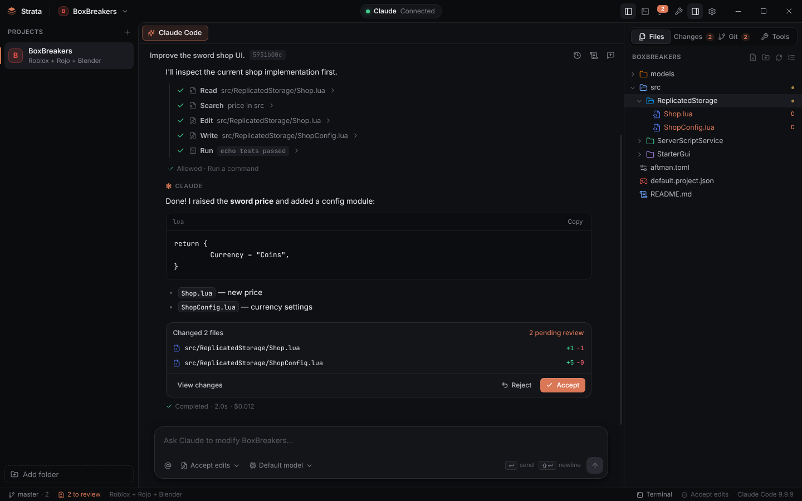
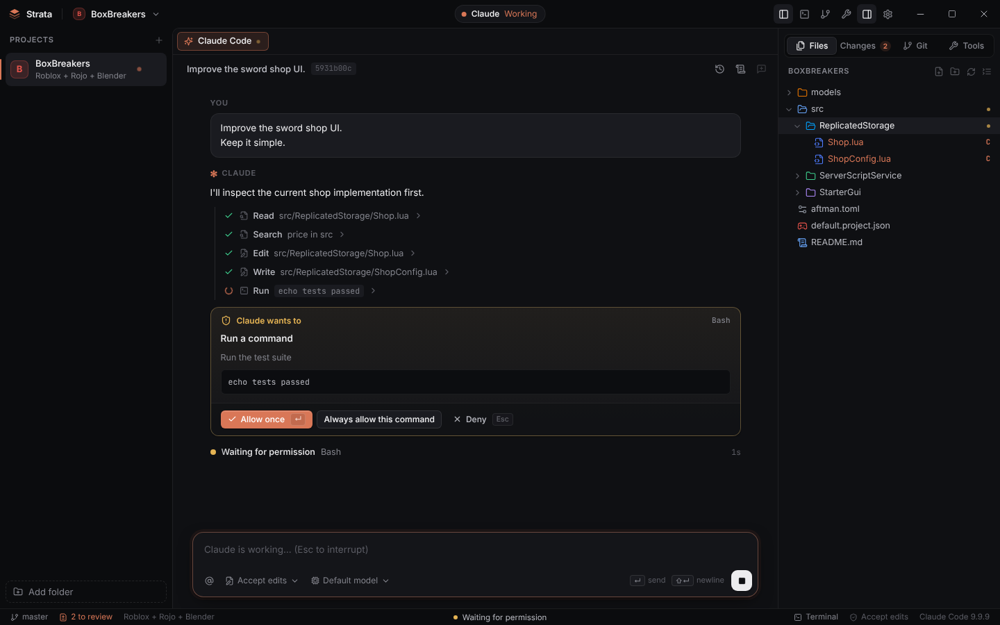
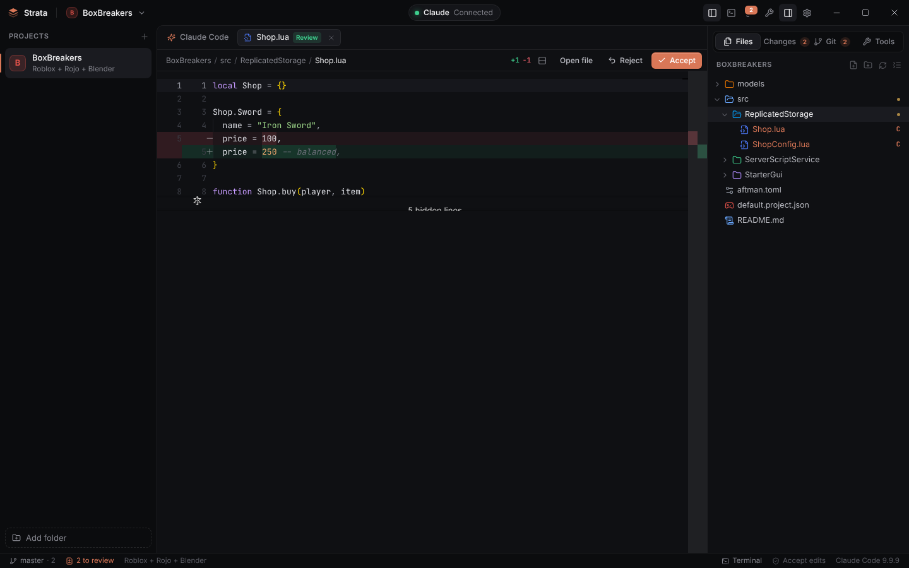
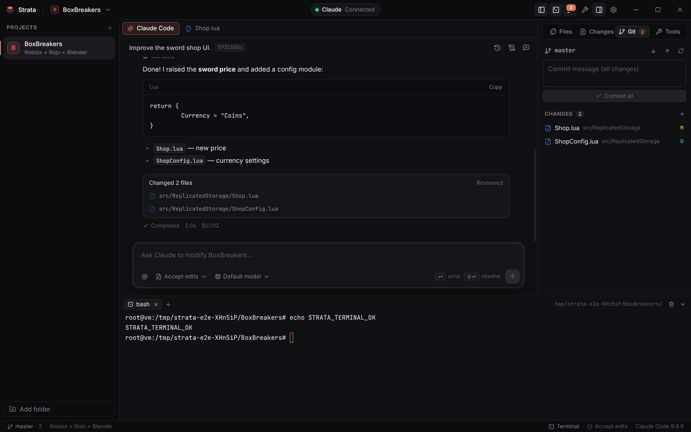
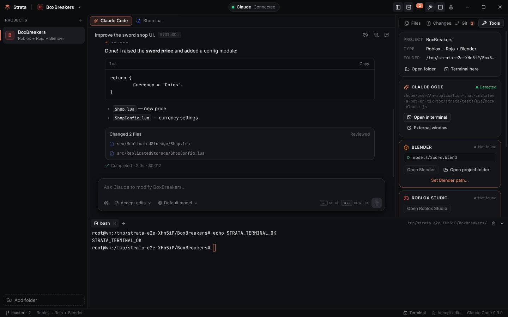

# Strata

**Strata** — десктопное приложение для Windows: рабочая оболочка и AI IDE вокруг **Claude Code CLI**.
Открываете любую папку, и Claude Code сразу запускается в ней как в рабочей директории. В одном окне есть
чат с Claude, редактор кода, diff-ревью изменений, терминал PowerShell, Git, а также интеграции с Blender и Roblox Studio.

> Strata не заменяет Claude Code. Она запускает установленный у вас `claude` CLI и даёт ему графический интерфейс.



| Запрос разрешения | Ревью изменений (diff) |
| --- | --- |
|  |  |

| Терминал в папке проекта | Blender / Roblox / инструменты |
| --- | --- |
|  |  |

---

## Установка (Windows)

1. Установите Claude Code и один раз авторизуйтесь в нём:
   ```powershell
   npm install -g @anthropic-ai/claude-code   # или нативный установщик Claude Code
   claude                                      # выполните /login
   ```
   Для Claude Code на Windows также нужен [Git for Windows](https://git-scm.com/download/win).
2. Скачайте `Strata-Setup-x.y.z.exe` (установщик) или `Strata-x.y.z-win-x64.zip` (portable-версия):
   - из **GitHub Actions → workflow “Strata” → Artifacts → `Strata-Windows`**;
   - или из GitHub Releases, если опубликован тег `strata-v*`.
3. Запустите Strata → **Open Project** → выберите папку. Готово.

### Сборка из исходников

```powershell
cd strata
npm install
npm run dist:win      # → release\Strata-Setup-0.1.0.exe и release\Strata-0.1.0-win-x64.zip
```

Режим разработки с hot reload: `npm run dev`.

---

## Что умеет

**Проекты.** Любая папка становится проектом: её можно открыть через стандартный диалог Windows,
добавить сразу несколько папок или создать новый workspace. Список недавних проектов сохраняется, можно
закреплять проекты и переключаться между ними. «Remove from list» убирает папку только из списка,
файлы на диске остаются.

**Claude Code.**
- CLI находится автоматически: PATH, `%USERPROFILE%\.local\bin`, `%APPDATA%\npm` и т.д.
  Путь можно указать вручную в Settings.
- Статус в заголовке окна: `Claude ● Connected`, `Sign in required` или `Not found`.
- Для каждого проекта запускается свой процесс `claude` с рабочей директорией = папка проекта.
  Strata общается с ним по официальному протоколу `stream-json`.
- В чате видно потоковый ответ (markdown), шаги работы (*Read*, *Edit*, *Run*, *Search*…), план задач
  (TodoWrite) и состояние: *Thinking / Reading files / Editing files / Running command /
  Waiting for permission / Completed*.
- **Разрешения:** если Claude хочет выполнить команду или изменить файл, в чате появляется карточка
  с кнопками **Allow once / Always allow / Deny** (Enter / Esc).
- **Режимы работы:**
  - *Ask first* — Strata спрашивает разрешение на всё;
  - *Accept edits* (по умолчанию) — правки файлов применяются сразу, но попадают на ревью,
    а команды по-прежнему требуют разрешения;
  - *Plan* — Claude только исследует проект и предлагает план;
  - *Bypass* — Claude работает без подтверждений.
- **Accept / Reject:** перед каждой правкой Strata сохраняет снимок файла. Каждое изменение можно
  открыть в diff-виде и принять или откатить. Если отклонить созданный Claude файл, он уходит в корзину.
- Сессии: можно начать новую сессию или продолжить любую прошлую. Список сессий и их история
  берутся из `~/.claude/projects`.
- Если Claude Code не авторизован, появится сообщение «Claude Code needs to be authenticated» и кнопка
  **Open Claude Code**: она открывает `claude` во встроенном терминале, где можно выполнить `/login`.
- **Контекст чата:** рядом с кнопкой отправки показан размер контекста (`141K · 71%`). Когда чат
  становится длинным, над полем ввода появляется предложение начать новый. Команда `/clear` (или `/new`)
  и кнопка New session начинают чистый чат.
- **Effort:** Settings → Claude Code → Effort передаётся в CLI как `--effort`.
- **MCP-серверы по проектам:** на вкладке Tools можно выключить любой MCP-сервер (например, Roblox Studio в
  одном проекте и Blender в другом). Strata читает серверы из `~/.claude.json` и `.mcp.json`. Если
  что-то выключено, Claude Code запускается с `--strict-mcp-config` и загружает только оставшиеся серверы
  (серверы из плагинов и коннекторов в этом режиме не подключаются).
- Подробный лог протокола: кнопка 📜 в шапке чата.
- В сообщениях можно ссылаться на файлы: `@` с автодополнением путей. Также доступно
  «Ask Claude about this» в контекстном меню файла и Ctrl+Shift+L для выделения в редакторе.

**Терминал.** Полноценный терминал на xterm.js + ConPTY (PowerShell 7 или Windows PowerShell, есть
выбор cmd / Git Bash). Он открывается в папке проекта, поддерживает вкладки и работает с npm, git,
python, node, rojo, claude, blender и любыми другими командами.

**Файлы.** Виртуализированное дерево с ленивой загрузкой, поэтому большие проекты не тормозят.
Поддерживаются создание, переименование (F2), удаление в корзину (Del), создание папок, drag & drop
внутри дерева и из Проводника Windows. Изменённые файлы подсвечиваются: Git — M/U/A/D, правки
Claude — C.

**Редактор.** Monaco (движок VS Code) с подсветкой Lua/Luau (включая Roblox API), Python, JS/TS,
JSON, HTML, CSS, C# и десятков других языков. Есть Ctrl+S, превью-вкладки и уведомление о том, что
файл изменился на диске.

**Git.** В панели видны ветка, ahead/behind, staged- и unstaged-файлы. Можно делать stage, unstage
и discard, коммитить, а также push и pull. Diff строится против HEAD.

**Blender.** Strata находит Blender в `Program Files\Blender Foundation\*`, Steam или PATH.
Папки с `.blend` распознаются как Blender-проекты. Есть кнопки **Open Blender** и
**Open Project Folder**, а `.blend`-файл открывается в Blender из контекстного меню. Blender MCP можно
подключить в самом Claude Code (`claude mcp add …`), и Strata будет использовать его автоматически.

**Roblox.** Strata находит Roblox Studio в `%LOCALAPPDATA%\Roblox\Versions` и Rojo (Aftman / Rokit /
Foreman / PATH). Roblox-проект распознаётся по признакам `.rbxl`, `.rbxlx`, `*.project.json` и
`src/ReplicatedStorage`. Есть кнопки **Open Roblox Studio** и **Start rojo serve**.

**Определение типа проекта:** Roblox (+ Rojo), Blender, Node.js, Python, C#, Unity, Web, Rust, Go, Lua, Git.
Strata смотрит только верхний уровень папки и не сканирует весь диск.

**Настройки:** General, Appearance (темы Dark / Midnight / Light, акцентный цвет, масштаб), Claude Code,
Terminal, Editor, Projects (в том числе сохранённые правила «Always allow»), Roblox, Blender, Git.

### Горячие клавиши

| | |
|---|---|
| Ctrl O | открыть папку |
| Ctrl L | фокус на чат Claude |
| Enter / Shift+Enter | отправить / новая строка |
| Esc | прервать Claude / отклонить запрос |
| Ctrl \` | терминал |
| Ctrl B / Ctrl Shift B | левая / правая панель |
| Ctrl Shift G / Ctrl Shift E | Git / Files |
| Ctrl S | сохранить файл |
| Ctrl , | настройки |

---

## Безопасность и приватность

- Strata **не хранит логин и пароль** Claude: используется существующая авторизация Claude Code.
- Strata сама ничего никуда не отправляет. Сетевые запросы делает только Claude Code CLI к своим сервисам.
- Renderer изолирован (`contextIsolation`, `sandbox`, строгий CSP). Все файловые, git- и терминальные
  операции из UI разрешены только внутри папок, которые вы добавили как проекты.
- Без вашего подтверждения команды не выполняются (кроме режима *Bypass*, который включается явно).
- Удаление файлов идёт в корзину, а отклонённые правки восстанавливаются из снимка.

---

## Архитектура

Стек: **Electron + React + TypeScript** (electron-vite). Терминал — **node-pty**
(N-API prebuilds с ConPTY для Windows) и **xterm.js**. Редактор — **Monaco**, локально, без CDN.

```
strata/
├─ src/main/              # main process (Node.js)
│  ├─ index.ts            # окно, жизненный цикл, безопасность
│  ├─ ipc.ts              # IPC-API для renderer
│  ├─ claude.ts           # Claude Code process manager (stream-json, разрешения, interrupt)
│  ├─ changes.ts          # снимки файлов → Accept / Reject
│  ├─ sessions.ts         # история сессий из ~/.claude/projects
│  ├─ terminal.ts         # terminal manager (node-pty)
│  ├─ filesystem.ts       # filesystem manager + watcher
│  ├─ projects.ts         # project manager + определение типа проекта
│  ├─ tools.ts            # обнаружение Claude / Blender / Roblox Studio / Rojo / Git
│  ├─ git.ts              # git CLI
│  └─ paths.ts / exec.ts / store.ts / settings.ts
├─ src/preload/           # contextBridge: window.strata API
├─ src/shared/            # общие типы и контракт API
└─ src/renderer/          # React UI (zustand-сторы, компоненты, стили)
```

### Тесты

```bash
npm run typecheck
npm test                                   # unit-тесты логики main-процесса
npm run build && node tests/e2e/run.cjs    # e2e: настоящий Electron + Playwright + мок Claude CLI
STRATA_EXE=release/win-unpacked/Strata.exe node tests/e2e/run.cjs   # e2e упакованной сборки
node tests/e2e/real-claude.cjs             # smoke-тест с настоящим Claude Code (тратит токены)
```

E2E-тест проходит через весь интерфейс: welcome-экран, открытие проекта, определение типа, чат,
запрос разрешения, правки на диске, diff, Reject/Accept, редактор с сохранением, Git, терминал,
создание файла, настройки, тему, ошибку авторизации и удаление проекта из списка. Тест запускается
в CI на `windows-latest` для упакованного `Strata.exe`.
